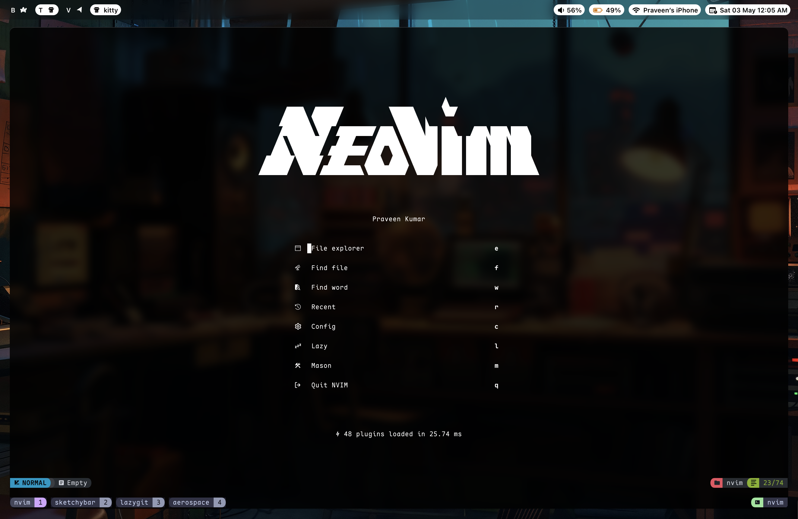
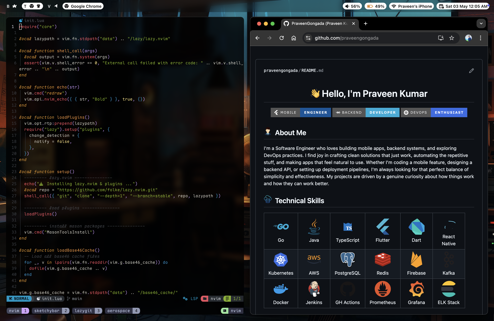

<div align="center">


<br/>


<a href="https://opensource.org/licenses/MIT"></a>

_A carefully curated collection of configuration files for a productive development environment_

</div>

## 📸 Screenshots

<div align="center">
  
  
</div>

_For more screenshots, see [Showcase](docs/showcase.md)_

## 📦 What's Inside

This repository contains configuration files for various tools and applications:

- **[zshrc](zshrc/)** - Z Shell configuration
- **[nvim](nvim/)** - Neovim configuration
- **[vim](vim/)** - Plugin-free Vim config mirroring the Neovim keymaps
- **[tmux](tmux/)** - Terminal multiplexer configuration
- **[ghostty](ghostty/)** - GPU-accelerated terminal emulator
- **[kitty](kitty/)** - GPU-based terminal emulator
- **[wezterm](wezterm/)** - GPU-accelerated cross-platform terminal emulator
- **[lazygit](lazygit/)** - Terminal UI for git commands
- **[sketchybar](sketchybar/)** - macOS status bar replacement
- **[aerospace](aerospace/)** - Window manager for macOS
- **[yazi](yazi/)** - Terminal file manager
- **[oh-my-posh](oh-my-posh/)** - Prompt theme engine
- **[zed](zed/)** - Zed editor settings and keymap
- **[vscode](vscode/)** - VS Code / Cursor settings and keybindings
- **[k9s](k9s/)** - Kubernetes TUI configuration
- **[homebrew](homebrew/)** - Package manager Brewfile
- **[fonts](fonts/)** - Custom fonts collection
- **[wallpapers](wallpapers/)** - Custom wallpapers

## 🚀 Install

```bash
/bin/bash -c "$(curl -fsSL https://raw.githubusercontent.com/PraveenGongada/dotfiles/main/setup.sh)"
```

Or from a clone: `./setup.sh`.

Safe to re-run: it only does what's missing and never overwrites files you already have
(`--force` replaces them, backing up the originals). `./setup.sh --help` for all options.

Afterwards open a new terminal, and start `nvim` once to install plugins.

**Update package list**

```bash
brew bundle dump --force --file ~/.config/homebrew/Brewfile --no-describe --tap --formula --cask
```

## 📖 Documentation

Component-specific guides:

- **SketchyBar**: [Configuration guide](sketchybar/README.md)
- **Tmux**: [Key bindings and usage](tmux/README.md)

## ⚙️ Customization

These dotfiles are designed to be forked and customized. Key areas to modify:

- `zshrc/.zshrc` - Shell aliases and functions
- `nvim/` - Neovim configuration and plugins
- `sketchybar/` - Status bar appearance and widgets
- `homebrew/Brewfile` - Additional packages to install

## 📝 License

This project is licensed under the MIT License - see the [LICENSE](LICENSE) file for details.

## 🙏 Acknowledgments

- [GNU Stow](https://www.gnu.org/software/stow/) for symlink management
- All the open-source projects that made these configurations possible
